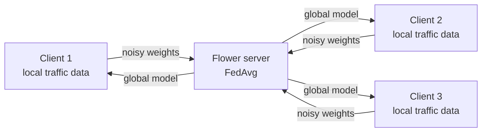

# Federated Learning for IoT Attack Detection

Detects attacks in IoT network traffic with **federated learning**: several sites (clients) train a shared classifier together, but each site's traffic data never leaves it. Only model weights are exchanged, with added Gaussian noise for privacy.

Built with [Flower](https://flower.ai) (federated learning framework) and scikit-learn.

## How it works



Each round:
1. The server sends the global model (an `SGDClassifier`, logistic loss) to every client.
2. Each client continues training on its own data (`partial_fit`), then adds Gaussian noise to its weights. The noise decreases each round: `sigma = noise × e^(−decay × round)`.
3. The server averages the clients' weights, weighted by their number of samples (**FedAvg**), and reports the weighted test accuracy.

Federated training starts from zero weights. Three **centralised baselines** (SGD, Gaussian Naive Bayes, Hoeffding Tree) trained on the pooled data give the reference accuracy that federated training should approach.

## Dataset

Network-flow CSV files with an `Attack Name` column (benign traffic and attack types):
[Google Drive folder](https://drive.google.com/drive/folders/10JnoebnK9jtpy8uFfy2zLryVK9gy-nEa?usp=sharing)

Identifier columns (`Flow ID`, `Src IP`, `Dst IP`, `Timestamp`, `Label`) are dropped, only numeric flow features are used, and infinite values are treated as missing. Put the merged dataset at `data/full_dataset.csv` (the `data/` folder is not tracked by Git).

## Project structure

| File | Purpose |
|---|---|
| `preprocessing.py` | Shared loading and cleaning, so every script sees the same features and labels |
| `train_baseline.py` | Centralised baselines; the SGD run also saves the shared preprocessing (features, scaler, class list) |
| `split_clients.py` | Splits the dataset into one stratified CSV per client |
| `server.py` | Flower server: FedAvg, weighted accuracy, results per round |
| `client.py` | Flower client: local training, adaptive Gaussian noise, evaluation |
| `run_local.sh` | Starts the server and all clients on one machine |

## Run it

```bash
pip install -r requirements.txt

# 1. Centralised baselines (run sgd first: it creates the shared preprocessing)
python train_baseline.py --data data/full_dataset.csv --model sgd
python train_baseline.py --data data/full_dataset.csv --model naive_bayes
python train_baseline.py --data data/full_dataset.csv --model hoeffding

# 2. One data file per client
python split_clients.py --data data/full_dataset.csv --clients 3

# 3. Federated training: 3 clients, 10 rounds
./run_local.sh 3 10
```

Or start each part in its own terminal: `python server.py --clients 3`, then `python client.py --id 1`, `--id 2`, `--id 3`.

Client options: `--noise` (initial noise standard deviation, default 0.05), `--decay` (default 0.1), `--epochs` (local passes per round, default 1).

## Pipeline test

The full pipeline was tested on a **synthetic** dataset with the same column structure (4,000 flows, 4 classes), not on the real data:

| Model | Accuracy |
|---|---|
| Centralised SGD | 0.90 |
| Centralised Naive Bayes | 0.98 |
| Centralised Hoeffding Tree | 0.98 |
| Federated SGD, 3 clients: round 1 → round 5 | 0.82 → 0.89 |

Results on the real dataset will differ: run the steps above to obtain them.

## Limitations

- The added noise improves privacy but is **not formal differential privacy**: there is no weight clipping and no privacy budget (ε) accounting.
- `split_clients.py` produces an IID split (same class mix per client). Real sites usually have different traffic, which makes federated training harder.
- The scaler and median fill values are fitted on the pooled dataset for simplicity. In a strict deployment, they would be agreed between sites without sharing raw data.
